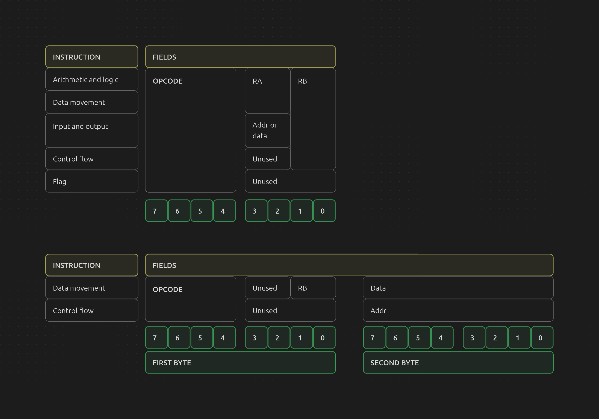

# Intro 

The 'Scott Cpu' is a simple educational 8-bit processor designed by J. Clark Scott in his book [But How Do It Know? - The Basic Principles of Computers for Everyone](https://www.amazon.com/dp/0615303765?lv=shuf&channelId=500&plpRedirect=mhFallback) as an educational tool to teach computer principles to its readers.
The goal of this document is to serve as a datasheet for the processor, and the system surrounding it, that was studied in the book mentioned above to serve as a reference for a future project, a "Scott Cpu emulator" written in the C++ programming language.

---
# Prequisites

---
# Table of contents


---
# 1. Terminology

In addition to the terms used in J. Clark Scott's _But How Do It Know?_, this document defines the following terms for clarity:

- **Component:** A major functional unit of the system. This includes the CPU, the [RAM](#31-ram), and every peripheral connected to the CPU (such as the keyboard and screen).
- **Sub-component:** A part contained within a component. This includes registers (such as the MAR or the instruction register) and any other internal unit, such as the ALU.
- **System:** The complete Scott CPU computer and the other components : CPU, [RAM](#31-ram), and peripherals together.
- **Peripheral:** A component that is not the CPU or [RAM](#31-ram), such as the keyboard and screen.
- **Pin:** A single connection point of a component or sub-component. Every component connects to an outside wire via a pin.
- **Signal:** The value carried on a pin or wire (high/low, 1/0).
- **Port:** A group of related pins treated as one unit (e.g., an 8-bit data port).
- **von Neumann architecture:** Von Neumann Architecture refers to a computer architecture based on the design proposed by mathematician and physicist John Von Neumann in 1945. It consists of a processing unit, a control unit, and a memory to store data and instructions.
- **Addr:** Short for address

And since this reference is meant for people who already read the book, terms defined in it will not be redefined here.

---
# 2. System overview
*(not done yet)*

---
# 3. Components
## 3.1 RAM
#### 3.1.1 description 

**The Scott CPU's** four general-purpose registers *(R0 to R3)* hold only 32 bits in total, which is far too little for storing programs and data. To make up for this, the system includes a main memory , [RAM](#31-ram) *(Random Access Memory)* consisting of 256 8-bit registers, giving a capacity of 256 bytes. Each location is identified by a unique 8-bit address in the range ```0x00``` to ```0xFF``` (0 to 255).
#### 3.1.2 Specification
| Parameter           | Value                         |
| ------------------- | ----------------------------- |
| Capacity            | 256 bytes                     |
| Word size           | 8 bits (1 byte)               |
| Number of addresses | 256 (```0x0``` to ```0xFF```) |
| Address width       | 8 bits                        |
| Data width          | 8 bits                        |
| Sub-components      | [MAR](#314-mar)               |
| Read operation      | 1 clock cycle                 |
| Write operation     | 1 clock cycle                 |

#### 3.1.3 Pin description

| Pin | Name   | Direction     | Width (in bits) | Description                                                   |
| --- | ------ | ------------- | --------------- | ------------------------------------------------------------- |
| a   | ADDR   | Input         | 8               | Reads an address from the system's bus to the [MAR](#314-mar) |
| s0  | SET    | Input         | 1               | Sets the [MAR](#314-mar) register                             |
| s1  | ENABLE | Input         | 1               | Enables the [MAR](#314-mar) register                          |
| i/o | DATA   | Bidirectional | 8               | Reads and writes data from and into the system's bus.         |
| s   | SET    | Input         | 1               | Write the i/o value to the addressed byte                     |
| e   | ENABLE | Input         | 1               | Put the addressed byte on i/o                                 |

#### 3.1.4 MAR
Access to the [RAM](#31-ram) is controlled by the **Memory Address Register**, an 8-bit register that holds the address of the location to be read or written. All transfers between the [RAM](#31-ram) and the data bus, in either direction, use the address currently stored in the **MAR**. The target address must therefore be loaded into the **MAR** by the load and store intructions before the read or write operation begins.

## 3.2 CPU

#### 3.2.1 Overview

**The Scott CPU** is an 8-bit educational processor designed to show how a computer works from the ground up. It is built entirely from basic logic gates and follows a **Von Neumann** architecture, with a single 8-bit data bus connecting its components: four general-purpose registers (R0 to R3), an arithmetic logic unit (ALU) with status flags, a control section driven by a clock and stepper, and 256 bytes of [RAM](#31-ram). 
Instructions are fetched from memory and executed in a fixed six-step cycle, and the compact instruction set covers arithmetic and logic operations, data movement, jumps, and input/output. 

#### 3.2.2 Specification

| Parameter          | Specification                                          |
| ------------------ | ------------------------------------------------------ |
| Architecture       | Custom 8-bit, von Neumann (shared program/data memory) |
| Data width         | 8 bits                                                 |
| Address width      | 8 bits                                                 |
| Addressable memory | 256 bytes ([RAM](#31-ram))                             |
| Implementation     | Built entirely from basic logic gates (NAND-based)     |
| Endianness         | Not applicable (single-byte data)                      |
| Instruction length | 1 byte (2 bytes for DATA, JMP, JCAEZ)                  |
#### 3.2.3 Pin description

| Pin        | Name                   | Direction     | Width (in bits) | Description |
| ---------- | ---------------------- | ------------- | --------------- | ----------- |
| Bus system | ```Addr```, ```Data``` | Bidirectional | 8               |             |
| s          | ```Data```             | Output        | 1               |             |

#### 3.2.4 Registers
-  **R0, R1, R2 and R3 :** *(8-bit each)* the **general-purpose** registers of this system, connected to the system's bus and the control section. Can be set and enabled.
- **ACC** **:** *(8-bit)* Stands for **accumulator**, the input cames from the ALU and the output is the system's bus. Can be set and enabled.
- **TMP :** *(8-bit)* Stands for **temporary**, its input is the system's bus and it outputs to the Bus 1. Can only be set since there's no need to control when it outputs bits.
- **IR :** *(8-bit)*
- **IAR :** *(8-bit)*
- **Flags** : After each operation, the ALU reports its outcome through four single-bit flags, which are saved in the flags register and can be used by conditional jump instructions:
	- *Carry:* Set when an addition overflows 8 bits, or when a shift pushes a bit out.
	- *A-larger:* Set when the first input is greater than the second.
	- *Equal:* Set when both inputs are identical.
	- *Zero:* Set when the result is all zeros.

| General prupose register | encoding |
| ------------------------ | -------- |
| R0                       | ```00``` |
| R1                       | ```01``` |
| R2                       | ```10``` |
| R3                       | ```11``` |
#### 3.2.5 Bus 1

A device positioned between the TMP register and the ALU. A part from the 8-bit value it receives from the TMP it has a one bit input, if on, it ignores the input received from the TMP and outputs the 8-bit signal ```0b00000001``` (equivalent to 1 in decimal) to the ALU (the 'b' intput pin).
this is needed since certain instructions require the ALU to have a value of one in the 'b' input (see ).
#### 3.2.6 ALU

##### description

The **ALU** is the part of the Scott CPU that does all of its calculations and comparisons. It takes two 8-bit inputs, performs one operation on them, and produces an 8-bit result plus a few status flags.
#####  Pin description

| Pin        | Role       | Direction | Width  (bits) | Description                                                                 |
| ---------- | ---------- | --------- | ------------- | --------------------------------------------------------------------------- |
| a          | ```Data``` | Input     | 8             | First 8-bit operand (from the bus).                                         |
| b          | ```Data``` | Input     | 8             | Second 8-bit operand (from the TMP register).                               |
| c          | ```Data``` | Output    | 8             | 8-bit result of the operation, passed to the ACC register.                  |
| carry in   | ```Data``` | Input     | 1             | 1-bit carry from the flags register, used by ADD, which adds it to the sum. |
| op         | ```Data``` | Input     | 3             | 3-bit operation select that chooses which ALU operation is performed.       |
| carry out  | ```Data``` | Output    | 1             | Set when an addition overflows 8 bits or a shift pushes a bit out.          |
| 'a' larger | ```Data``` | Output    | 1             | Set when operand a is greater than operand b.                               |
| equal      | ```Data``` | Output    | 1             | Set when operands a and b are identical.                                    |
| zero       | ```Data``` | Output    | 1             | Set when the result c is all zeros.                                         |
##### Operation set of the ALU and 'op'

The 'op' input (see pin description of the ALU) feeds into a *3x8 decoder* that will decide which operation the ALU will carry according to the value of 'op'.

| Operation | 'op' code |
| --------- | --------- |
| ADD       | ```000``` |
| SHR       | ```001``` |
| SHL       | ```010``` |
| NOT       | ```011``` |
| AND       | ```100``` |
| OR        | ```101``` |
| XOR       | ```110``` |
| CMP       | ```111``` |
#### 3.2.7 Instruction set

The scot system uses a custom instruction set with *8 arithmetic and logic* instruction, *3 data movement*, *1 flag instruction*, *17 control flow* and *2 input and output* instructions.
Each instruction can be expressed in two forms: assembly and machine code.

- **An assembly representation :** Each instruction is identified by a mnemonic, followed by its operands in the order listed in the instruction tables:
  ```<mnemonic> <operand 1>, <operand 2>``` 
  For example, to add register R1 to register R3 and store the result in R3: 
  ```ADD R1, R3```
  Unlike the mahine code representation which is meant to be decoded by the cpu, the asssembly representation is meant to be a human readable version of machine.

- **A machine code representation :** Each instruction is encoded as one or two bytes. The upper four bits of the first byte form the opcode field, which selects the operation. The remaining bits hold the operand fields. Instructions that carry immediate data, use a second byte for that value. The instruction formats and the meaning of each field are described below. Bit 7 is the most significant bit and bit 0 is the least significant bit.


##### Arithmetic and logic instructions

| Instruction  | Mnemonic | Opcode     | Operands            | Width | Description                                          |
| ------------ | -------- | ---------- | ------------------- | ----- | ---------------------------------------------------- |
| add          | ADD      | ```1000``` | ```RA```, ```RB```  | 8     | Add ```RA``` and ```RB``` and put answer in ```RB``` |
| shift right  | SHR      | ```1001``` | ```RA```, ```RB```  | 8     | Shift ```RA``` Right and put answer in ```RB```      |
| shift left   | SHL      | ```1010``` | ```RA```, ```RB```  | 8     | Shift ```RA``` Left and put the answer in ```RB```   |
| not          | NOT      | ```1011``` | ```RA```, ```RB```  | 8     | Not ```RA``` and put the answer in ```RB```          |
| and          | AND      | ```1100``` | ```RA```, ```RB```  | 8     | And ```RA``` and ```RB``` and put answer in ```RB``` |
| or           | OR       | ```1101``` | ```RA```, ```RB```  | 8     | Or ```RA``` and ```RB``` and put answer in RB        |
| exclusive or | XOR      | ```1110``` | ```RA```, ```RB```  | 8     | Exclusive OR ```RA``` and ```RB``` into ```RB```     |
| compare      | CMP      | ```1111``` | ```RA```, ```RB```  | 8     | Compare ```RA``` and ```RB```                        |
##### Data movement instructions

| Instruction | Mnemonic | Opcode     | Operands            | Width | Description                                           |
| ----------- | -------- | ---------- | ------------------- | ----- | ----------------------------------------------------- |
| data        | DATA     | ```0010``` | ```RB```,```data``` | 16    | Load an 8-bit value in ```RB```                       |
| load        | LD       | ```0000``` | ```RA```, ```RB```  | 8     | Load ```RB``` from [RAM](#31-ram) address in ```RA``` |
| store       | ST       | ```0001``` | ```RA```, ```RB```  | 8     | Store ```RB``` to [RAM](#31-ram) address in ```RA```  |
##### Flag instructions

| Instruction | Mnemonic | Opcode     | Operands | Width | Description     |
| ----------- | -------- | ---------- | -------- | ----- | --------------- |
| clear flags | CLF      | ```0110``` | None     | 8     | Clear all flags |
##### Control flow instructions

| Mnemonic | Opcode     | Operands   | Width | Description                             |
| -------- | ---------- | ---------- | ----- | --------------------------------------- |
| JMPR     | ```0011``` | ```RB```   | 8     | Jump to the address in ```RB```         |
| JMP      | ```0100``` | ```addr``` | 16    | Jump to ```Addr```                      |
| JA       | ```0101``` | ```addr``` | 16    | Jump if Carry is on                     |
| JC       | ```0101``` | ```addr``` | 16    | Jump if A is larger than B              |
| JE       | ```0101``` | ```addr``` | 16    | Jump if A is Equal to B                 |
| JZ       | ```0101``` | ```addr``` | 16    | Jump if the answer is Zero              |
| JCA      | ```0101``` | ```addr``` | 16    | Jump if Carry or A larger               |
| JCE      | ```0101``` | ```addr``` | 16    | Jump if Carry or A Equal B              |
| JCZ      | ```0101``` | ```addr``` | 16    | Jump if Carry or answer is Zero         |
| JAE      | ```0101``` | ```addr``` | 16    | Jump if A is larger or Equal to B       |
| JAZ      | ```0101``` | ```addr``` | 16    | Jump if A is larger or answer is Zero   |
| JEZ      | ```0101``` | ```addr``` | 16    | Jump if A Equals B or answer is Zero    |
| JCAE     | ```0101``` | ```addr``` | 16    | Jump if Carry or A larger or Equal to B |
| JCAZ     | ```0101``` | ```addr``` | 16    | Jump if Carry or A larger or Zero       |
| JCEZ     | ```0101``` | ```addr``` | 16    | Jump if Carry or A Equals B or Zero     |
| JAEZ     | ```0101``` | ```addr``` | 16    | Jump if A larger or Equal to B or Zero  |
| JCAEZ    | ```0101``` | ```addr``` | 16    | Jump if Carry, A larger, Equal, or Zero |
##### I/O instructions

| Instruction    | Mnemonic | Opcode     | Operands             | Width | Description                          |
| -------------- | -------- | ---------- | -------------------- | ----- | ------------------------------------ |
| input data     | IN       | ```0111``` | ```data```, ```RB``` | 8     | Input I/O Data to ```RB```           |
| input address  | IN       | ```0111``` | ```Addr```, ```RB``` | 8     | Input I/O Address to ```RB```        |
| output data    | OUT      | ```0111``` | ```data```, ```RB``` | 8     | Output ```RB``` to I/O as ```data``` |
| output address | OUT      | ```0111``` | ```Addr```, ```RB``` | 8     | Output ```RB``` to I/O as ```Addr``` |
#### 3.2.8 Control section

##### description

The control section coordinates the operation of all other CPU components. Driven by the system clock, it executes each instruction in a repeating fetch-decode-execute cycle divided into six timed steps. During the fetch phase, the instruction is read from memory into the **IR** register and the instruction address is incremented. During the execute phase, the control logic decodes the opcode and, using the current step and the [ALU](#326-alu)  flags (carry, A-larger, equal, zero), generates the enable and set signals that control data transfers over the shared 8-bit bus and select the [ALU](#326-alu) operation.

##### Pin description

| Pin   | Name | Direction | Width (in bits) | Description |
| ----- | ---- | --------- | --------------- | ----------- |
| op    | DATA | Output    | 3               |             |
| bus 1 | SET  | Output    | 1               |             |
| i/o   | DATA | Output    | 3               |             |
| C     | DATA | Input     | 1               |             |
| A     | DATA | Input     | 1               |             |
| E     | DATA | Input     | 1               |             |
| Z     | DATA | Input     | 1               |             |

The control section can set every register in the cpu and enable all of them except the IR and TMP registers. Since the book didn't name the pins setting or enabling these registers we will create names for them for the sake of documentation.

| Pin            | Name   | Direction | Width (in bits) | Description                           |
| -------------- | ------ | --------- | --------------- | ------------------------------------- |
| s0, s1, s2, s3 | SET    | Output    | 1 (each)        | Sets the general purpose registers    |
| s_tmp          | SET    | Output    | 1               |                                       |
| s_iar          | SET    | Output    | 1               |                                       |
| s_ir           | SET    | Output    | 1               |                                       |
| s_acc          | SET    | Output    | 1               |                                       |
| s_mar          | SET    | Output    | 1               | Sets the [MAR](#314-mar) register     |
| s_ram          | SET    | Output    | 1               |                                       |
| s_flags        | SET    | Output    |                 |                                       |
| e0, e1, e3, e4 | ENABLE | Output    | 1               | Enables the general purpose registers |
| e_iar          | ENABLE | Output    | 1               |                                       |
| e_acc          | ENABLE | Output    | 1               |                                       |
| e_mar          | ENABLE | Output    | 1               |                                       |
| e_ram          | ENABLE | Output    | 1               |                                       |

And finally an 8 bit pin feeds the contents of the IR register when the s_ir is on

| Pin      | Name | Direction | Width (in bits) | Description                                                     |
| -------- | ---- | --------- | --------------- | --------------------------------------------------------------- |
| ir_input | DATA | Input     | 8               | Inputs the value in instruction register in the control section |

##### stepper

The stepper is a device that, apparte


##### Timing

| instuction       | step 1                               | step 2                    | step 3                     | . . .                              | step 7            |
| ---------------- | ------------------------------------ | ------------------------- | -------------------------- | ---------------------------------- | ----------------- |
| all instructions | *Enable*: IAR/bus 1 - *set*: ACC/MAR | *Enable*: RAM - *set*: IR | *Enable*: ACC - *set*: IAR | *(see the table below for 4 to 6)* | reset the stepper |

| instuction                | step 4                              | step 5                                                                          | step 6                     |
| ------------------------- | ----------------------------------- | ------------------------------------------------------------------------------- | -------------------------- |
| Arithmetic and logic      | *enable*: RB - *set*: TMP           | set the 'op' input in the ALU, enable RA and set ACC                            | *enable*: ACC -*set*: RB   |
| Load                      | *enable*: RA - *set*: MAR           | *enable*: RAM - *set*: RB                                                       | No action                  |
| Store                     | *enable*: RA - *set*: MAR           | *enable*: RB - *set*: RAM                                                       | No action                  |
| Clear flag                | *activate*: bus 1 - *set*: Flags    | No action                                                                       | No action                  |
| jump (JMP RB)             | *enable*: RB - *set*: IAR           | No action                                                                       | No action                  |
| jump (JMP ADDR)           | *enable*: IAR - *set*: MAR          | *enable*: RAM - *set*: IAR                                                      | No action                  |
| jump (all other variants) | *enable:* IAR/Bus 1, *set*: MAR/ACC | *enable*: ACC - *set*: IAR                                                      | *enable*: RAM - *set*: IAR |
| Input                     | No action                           | *set:* RB - *i/o bus*: clk e, data/addr (on if the first operand is an address) | No action                  |
| Output                    | *enable*: RB - *i/o bus*:           | No action                                                                       | No action                  |


